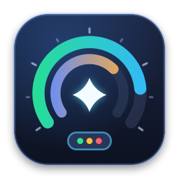

<div align="center">
  
  <h1>Apollo AgentMeter</h1>
  <p><strong>Native macOS Menu Bar Quota & Rate-Limit Monitor for Codex & Antigravity (Gemini / Claude / GPT / Argon)</strong></p>
  <p>原生 Apple Silicon 状态栏 AI 剩余额度与重置时间实时监控工具</p>
</div>

---

## ✨ 核心特性 (Features)

- **顶部状态栏一览无余**：常驻 macOS 状态栏，实时显示 `Codex ∞/xx% · Gemini xx%/xx%`（5h 短窗 / 7 天周窗剩余百分比）。
- **零打扰交互**：启动后默认静默折叠于状态栏，**仅当主动点击状态栏条目时才展开悬浮卡片**，再次点击或点击 `−` 即收起。
- **开箱即用自动发现**：
  - 自动读取本地 `~/.codex/sessions` 最新会话速率限制与重置时间戳，过期自动回满；
  - 自动发现本机运行中的 Antigravity Language Server（支持 Antigravity 2.x `~/.gemini/*/daemon/*.json` 元数据自动发现与旧版进程参数/端口兜底，自动绕过本地代理），动态拉取最新模型分组额度（`Gemini 模型`、`Claude / GPT 模型`、`Gemini 4 Argon`）。
- **三色健康度仪表**：
  - 🟢 **翠绿 (`<60%` 已用)**：额度充裕
  - 🟡 **琥珀黄 (`60%–80%` 已用)**：中度消耗预警
  - 🔴 **珊瑚红 (`>80%` 已用)**：高消耗告警徽标与高亮边框
- **高对比度深浅色主题 & 自由拖拽**：支持一键切换深色/浅色主题，按住卡片任意空白区域即可流畅拖动并自动记忆屏幕坐标。

---

## 📦 安装方式 (Installation)

### 方式一：通过 Releases DMG 安装（推荐）
1. 在 [Releases](../../releases) 页面下载最新的 **`Apollo-AgentMeter-1.0.0.dmg`**。
2. 双击挂载 DMG 镜像，将 **`AgentMeter.app`**（显示为 **Apollo AgentMeter**）拖入 **`Applications`** 文件夹。
3. 从「应用程序」或 Spotlight 启动即可。

> **提示**：如首次打开未公证的开源应用提示安全拦截，可在终端运行：
> ```bash
> xattr -cr "/Applications/AgentMeter.app"
> ```

### 方式二：从源码编译 (Build from Source)
无需复杂的 Xcode 工程，单文件纯原生 AppKit + SwiftUI 实现：
```bash
# 1. 生成多分辨率图标 AppIcon.icns
swift generate_icon.swift

# 2. 编译 Apple Silicon 原生二进制
swiftc -O -framework AppKit -framework SwiftUI AgentMeter.swift -o AgentMeter.app/Contents/MacOS/AgentMeter
```

---

## 📄 开源协议 (License)

MIT License © Apollo
